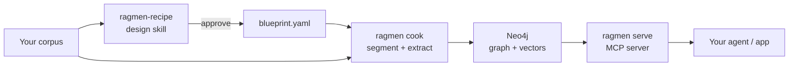

<div align="center">


# RAGmen Kitchen

**Noodles are nodes. Instant GraphRAG without the long cooking.**

Build and query runtime for approved GraphRAG blueprints. Sister repo: [ragmen-recipe](https://github.com/Kamaal404/ragmen-recipe) designs and signs off the blueprints that Kitchen cooks.

[](https://python.org)
[](https://neo4j.com)
[](https://modelcontextprotocol.io)
[](LICENSE)

</div>

## Results (eval/taste)

_Taste will be run once a corpus golden set exists. At that point the table below_
_will show recall@5, recall@10, MRR, and latency for baseline_vector vs ragmen_hybrid,_
_including where hybrid loses to the baseline so the schema can be fixed._

## Quickstart

```bash
# Validate an approved blueprint
ragmen toss vendor/blueprint/test-vectors/valid/minimal.yaml

# Cook a corpus (segment + extract dry run)
ragmen cook --profile legal --input ./corpus/ --chunks chunks.jsonl --graph graph.jsonl --limit 10

# Inspect the dry run output, then write to Neo4j:
ragmen cook --profile legal --input ./corpus/ --write

# Retrieve answers
ragmen query --profile legal "obligations of the employer"

# Evaluate retrieval
ragmen taste --profile firecraft --no-judge

# Start the MCP server
ragmen serve

# Test suite (offline, no API key or DB)
make test
```

## The menu

| Command | What it does | Status |
|---|---|---|
| `toss` | Validate blueprint schema, hash, approval, embedding dims | working |
| `cook` | Segment a corpus and extract a knowledge graph | working |
| `serve` | Read-only MCP server with hybrid search (vector + fulltext + graph) | working |
| `query` | One-shot cited answer from the corpus | working |
| `taste` | Evaluate retrieval against a golden set | working (--no-judge) |
| `simmer` | Entity resolution, incremental updates, drift reporting | stub |
| `recipe` | Design-time skill (runs in ragmen-recipe) | working (sister repo) |

## CLI reference

```
ragmen toss <blueprint> [--schema] [--verbose] [--neo4j]
ragmen cook --blueprint BP --input DIR [--profile P] [--write] [--limit N]
ragmen serve [--store memory|neo4j] [--blueprint BP]
ragmen query --profile P [--top-k N] "question"
ragmen taste [--profile P] [--golden PATH] [--no-judge] [--dry]
ragmen simmer --blueprint BP (stub — triggers re-extraction on blueprint change)
```

All commands exit 0 on success, 1 on blueprint rejection or threshold failure, 2 on usage error.

## Modules

| Module | What it does |
|---|---|
| `ragmen.registry` | Source registry, chunk store, ingest job ledger, embedding cache |
| `ragmen.cook` | Corpus ingestion: segment, extract (via neo4j-graphrag), build graph, query, validate |
| `ragmen.core` | Blueprint loading, validation, schema helpers |
| `ragmen.loaders` | Source file loaders (HTML, PDF) |
| `ragmen.eval` | Retrieval evaluation: baseline_vector vs ragmen_hybrid, recall/MRR, LLM judge |
| `ragmen.serve` | Read-only MCP server with hybrid search (vector + fulltext + graph traversal), citation, path explanation, schema |
| `ragmen.resolve` | Entity resolution against blueprint vocabularies (exact + fuzzy) |
| `ragmen.embed` | Vector embedding with content-hash caching (mock, local sentence-transformers) |
| `ragmen.report` | Drift report — unmapped mentions, pattern violations, vocabulary misses, hub candidates |
| `ragmen.store` | Abstract GraphStore interface + MemoryStore for offline testing |
| `ragmen.conflict` | Cross-source assertion conflict detection |

## Roadmap

### Built
- [x] Blueprint validation (schema, hash, approval, embedding, workload, guardrails)
- [x] Corpus segmentation with content addressing
- [x] Schema-grounded extraction with dry-run artifacts
- [x] Neo4j write, fulltext and vector indexes
- [x] Source registry with content hashing (re-add is a no-op)
- [x] Retraction with entity refcounting
- [x] Resumable ingest jobs (per-chunk checkpoint)
- [x] Embedding cache keyed by model and text
- [x] MCP server with search, expand, cite, explain_path, schema
- [x] CLI with toss, cook, serve, query, taste commands
- [x] Evaluation harness (baseline vs hybrid, recall@5/10, MRR, latency, citation validity)
- [x] LLM judge prompt for answer correctness scoring
- [x] CI threshold enforcement via eval/thresholds.yaml

### Planned / stubs
- [ ] `simmer`: entity re-resolution and drift report after blueprint change
- [ ] Batch extraction mode for cheaper, non-urgent runs
- [ ] `taste` LLM judge integration (needs API key)

## How it fits together



## Tests

```bash
make test                    # pytest (offline, no integration)
python -m pytest -q          # all tests including integration (needs Docker)
python -m pytest tests/test_cli.py -q   # CLI tests
```

All offline tests: 106 passed, 1 deselected (Neo4j integration).

## Eval / taste

Golden sets live in `eval/golden/<profile>.jsonl`. Each line:

```json
{"id": "q1", "question": "...", "answer": "...", "evidence_chunk_ids": [...], "type": "single_hop|multi_hop|global"}
```

Run evaluation:
```bash
ragmen taste --profile firecraft --no-judge    # retrieval metrics only, offline
ragmen taste --profile firecraft                # full eval with LLM judge (needs API key)
```

Thresholds in `eval/thresholds.yaml`. CI runs `taste --no-judge` and fails if any metric drops below its threshold.

## Notes

- No corpus ships with this repo. Bring your own documents.
- Do not commit API keys, Neo4j data, or source documents.
- Two repos: this one (kitchen/runtime) and [ragmen-recipe](https://github.com/Kamaal404/ragmen-recipe) (design-time blueprint skill).
- The repo URL has a trailing dash (`ragmen-kitchen-`). **Needs renaming to `ragmen-kitchen`** (no trailing dash). GitHub description and topics should be set from the repo settings page (not possible from this CLI).

## License

MIT