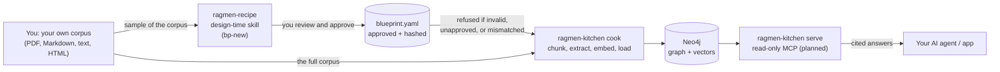

# ragmen-kitchen

Build and query runtime for approved GraphRAG blueprints.

This repository contains the `core`, `cook`, and `serve` packages under
`src/ragmen`. Cook is the build-time CLI; Serve will be the read-only MCP
server. The plugin is intentionally deferred until the runtime interfaces are
stable.

The design-time skill is maintained separately at
`Kamaal404/ragmen-recipe`. This repository and the skill are linked: the skill emits approved blueprints that this runtime consumes. Runtime refuses blueprints that are missing,
schema-invalid, incorrectly hashed, unapproved, unsupported, or incompatible
with the configured embedding dimensions.

Neo4j Community has one database per instance. Runtime stores one active
blueprint record on `(:_RagmenMeta)` with `blueprint_hash`,
`blueprint_version`, and approval fields. Ontology or embedding changes
require a new Neo4j instance or an explicit migration command; mixed graphs
are not allowed.

## How it fits together



Read it left to right. Each arrow is a handoff that can fail, and each one has
a check before the next step runs.

| Step | Command | Status | What it does |
|---|---|---|---|
| 1. Design | `ragmen recipe` (skill: `bp-new`) | planned | Reads a sample of your corpus and proposes a blueprint for you to approve |
| 2. Validate | `ragmen toss` | planned | Checks the blueprint schema, hash, and approval |
| 3. Build | `ragmen cook` | scripts exist, CLI stub | Chunks, extracts, embeds, and loads into Neo4j |
| 4. Query | `ragmen serve` | planned | Read-only retrieval over MCP |
| Tune | `ragmen taste` / `ragmen simmer` | planned | Evaluate retrieval quality; re-run after blueprint changes |

## Using your own content

This repository ships no corpus. Bring your own documents:

1. Put your files in a folder outside the repository, or in `samples/` locally
   and keep them untracked.
2. Run the design-time skill on a sample and approve the blueprint.
3. Run `ragmen cook` against your full corpus.

Do not commit source documents, API keys, or Neo4j data. The bundled test
fixtures are hand-written and exist only to test the pipeline.

## Features still to build

- [ ] `ragmen` CLI subcommands (currently a stub that prints "not implemented")
- [ ] Source registry with content hashing, so re-adding a file is a no-op
- [ ] Retraction that removes one source's chunks and keeps entities other sources share
- [ ] Resumable ingestion from a per-chunk job ledger
- [ ] Prompt caching for the blueprint block sent with every chunk
- [ ] Batch extraction mode for cheaper, non-urgent runs
- [ ] Embedding cache keyed by content hash
- [ ] Read-only MCP server (`serve`) with hybrid search and citations
- [ ] Golden-set evaluation (`taste`) with recall@k in CI
- [ ] Drift report that flags when the blueprint no longer fits the corpus
- [ ] Multi-source conflict handling (show both sides with attribution)

The migrated ingestion files under `src/ragmen/cook` originate from commit
`948b4e4` of the former `graphrag-builder` repository. The Fire Graph material
is an integration-test fixture, not a product.

```powershell
python -m pytest -q
```
