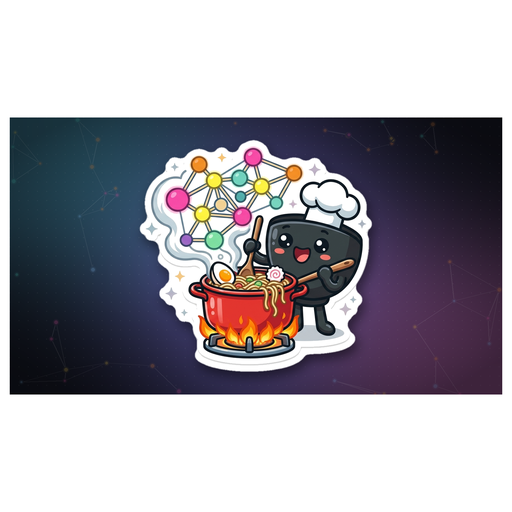
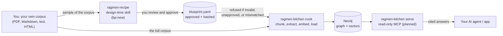

<div align="center">



# RAGmen Kitchen

**Noodles are nodes. Instant GraphRAG without the long cooking.**

Build and query runtime for approved GraphRAG blueprints. Cook is the build-time CLI; Serve will be the read-only MCP server.

[](https://python.org)
[](https://neo4j.com)
[](https://modelcontextprotocol.io)
[](LICENSE)
[](https://github.com/Kamaal404/ragmen-kitchen-/actions/workflows/contract.yml)

Sister repo: [ragmen-recipe](https://github.com/Kamaal404/ragmen-recipe) designs and signs off the blueprints that Kitchen cooks.

</div>

## Why

Plain RAG returns chunks. GraphRAG returns relationships. But schema design is the slow, painful part that most projects get wrong: you pick types and relations by intuition, build the graph, and discover weeks later that the ontology does not answer real questions. RAGmen splits the work. Recipe reads a sample of your corpus, proposes an ontology with justification, and makes you approve it before any extraction spend. Kitchen then executes that approved blueprint deterministically: chunk, extract, embed, load. No ontology drift, no guessing, no expensive mistakes hidden until query time.

## The menu

| Kitchen term | What it does | Status |
|---|---|---|
| **recipe** | Design and sign off a blueprint from a corpus sample | 🟢 working (in ragmen-recipe) |
| **toss** | Validate blueprint schema, hash, and approval | 🟢 working |
| **cook** | Chunk, extract, embed, load into Neo4j | 🟢 working |
| **simmer** | Entity resolution, incremental updates, drift reporting | 🟢 working |
| **taste** | Golden-set evaluation with recall@k in CI | ⚪ planned |
| **serve** | Read-only MCP server with hybrid retrieval and citations | 🟢 working |

## How it fits together



Read it left to right. Each arrow is a handoff that can fail, and each one has a check before the next step runs.

<div align="center">

</div>

## Quickstart

```bash
# VPS bootstrap (one time)
chmod +x setup.sh && ./setup.sh

# Or manually
pip install -r requirements.txt
docker compose up -d
cp .env.example .env   # then add your API keys

# Run the offline test suite
make test
```

The Makefile wraps every pipeline stage:

```bash
make segment PROFILE=legal INPUT=./your-corpus
make dry     PROFILE=legal LIMIT=10     # inspect graph.jsonl before paying to load
make init    PROFILE=legal
make load    PROFILE=legal
make validate PROFILE=legal
make query   PROFILE=legal Q="obligations of the employer"
```

`make help` lists every target. The `ragmen` CLI is a stub that prints "not implemented" -- use the Makefile or call `src/ragmen/cook/` scripts directly for now.

## Guardrails

Kitchen enforces the blueprint contract strictly. It will refuse a blueprint that is:

- Missing required fields
- Schema-invalid against `spec/blueprint.schema.json`
- Unapproved (no human sign-off recorded)
- Wrongly hashed (content hash does not match)
- Incompatible with the configured embedding dimensions

One active blueprint per Neo4j instance. The active hash is stored on a `(:_RagmenMeta)` node with `blueprint_hash`, `blueprint_version`, and approval fields. Mixed-graph scenarios (two blueprints in one database) are not supported. Ontology or embedding changes require a new Neo4j instance or an explicit migration command.

## Using your own content

This repository ships no corpus. Bring your own documents:

1. Put your files in a folder outside the repository and pass it as `INPUT`.
2. Run the design-time skill on a sample and approve the blueprint.
3. Run `make segment` and `make load` against your full corpus.

Do not commit source documents, API keys, or Neo4j data. The bundled test fixtures are hand-written and exist only to test the pipeline.

## Modules

Kitchen is organised into composable, domain-agnostic modules:

| Module | What it does |
|---|---|
| `ragmen.registry` | Source registry, chunk store, ingest job ledger, embedding cache |
| `ragmen.cook` | Corpus ingestion: segment, extract, build graph, query, validate |
| `ragmen.core` | Blueprint loading, validation, schema helpers |
| `ragmen.loaders` | Source file loaders (HTML, PDF) |
| `ragmen.resolve` | Entity resolution against blueprint vocabularies (exact, fuzzy, embedding, LLM tiers) |
| `ragmen.embed` | Vector embedding with content-hash caching (mock, local sentence-transformers) |
| `ragmen.report` | Drift report — unmapped mentions, pattern violations, vocabulary misses, hub candidates |
| `ragmen.store` | Abstract GraphStore interface + MemoryStore for offline testing |
| `ragmen.serve` | Read-only MCP server with hybrid search (vector + fulltext + graph traversal), citation, path explanation, schema introspection |
| `ragmen.conflict` | Cross-source assertion conflict detection |
| `ragmen.agent` | Answer policy engine — cited answers, conflict surfacing, corpus-scoped refusal |

## Roadmap

### Built
- [x] Source registry with content hashing, re-add is a no-op
- [x] Retraction that removes one source's chunks and keeps entities other sources share
- [x] Resumable ingestion from a per-chunk job ledger
- [x] Embedding cache keyed by model and text
- [x] Entity resolution (exact + fuzzy against blueprint vocabulary)
- [x] Drift report (unmapped mentions, pattern violations, vocab misses, hub candidates)
- [x] Abstract GraphStore interface (MemoryStore + Neo4j adapter)
- [x] MCP server with search, expand, cite, explain_path, schema tools
- [x] Answer policy engine with citation, conflict surfacing, out-of-corpus refusal
- [x] Conflict detection across multiple sources
- [x] Scoped incremental re-resolution (only re-resolve changed entities)
- [x] Drift threshold enforcement

### Planned
- [ ] Golden-set evaluation (`taste`) with recall@k in CI
- [ ] Batch extraction mode for cheaper runs
- [ ] Prompt caching for the blueprint block sent with every chunk

The migrated ingestion files under `src/ragmen/cook` originate from commit `948b4e4` of the former `graphrag-builder` repository. The Fire Graph material is an integration-test fixture, not a product.

## Tests

```bash
# Offline smoke test (no LLM, no database)
./tests/test_legacy_pipeline.sh

# Pytest suite
python -m pytest -q
```

Both suites run offline with no API key or Neo4j database.

## License

MIT.